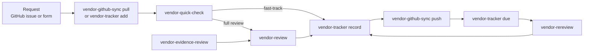

# Konda Security Third Party Risk Management for Claude Code

`tprm` is a Claude Code plugin for running a third party risk management program. It triages vendor requests, performs full vendor security and risk assessments, reviews vendor SOC 2 reports and other evidence, re-reviews vendors on a schedule, maintains the approved-services list, syncs requests and decisions with GitHub issues, and drafts the vendor management policy and process documents.

Everything works on a **workspace**: one folder per client that holds the approved-services list, the review records, and vendor-provided evidence, configured by a `tprm.json` file.

## Quick Start

```
/plugin install tprm --marketplace https://kondasecurity.com/claude/marketplace.json
```

Then, from the client's repository or folder:

```
/tprm:tprm-setup                          # once per client: create or adopt the workspace
/tprm:vendor-quick-check Acme Notes 42    # triage a request (issue #42)
/tprm:vendor-review https://acme.example  # full assessment when triage says so
/tprm:vendor-tracker record reviews/acme-2026-10-22.md
/tprm:vendor-github-sync push             # commit the record, post the decision to the issue
```

Plugin skills are listed as `/tprm:<skill>`. You can also type the short form, such as `/vendor-review`, unless another installed command uses the same name.

## Skills

| Skill | What it does | Cost |
|-------|--------------|------|
| `tprm-setup` | Creates `tprm.json`, the folders, and the tracker, or adopts an existing vendor review folder | Low |
| `vendor-quick-check` | Triages a request from the intake answers and a few web checks; fast-tracks low-risk tools or routes to a full review | Low, no subagents |
| `vendor-review` | Full assessment: 9 parallel research agents, 10 weighted dimensions, cited evidence, PDF | High |
| `vendor-evidence-review` | Reviews vendor-provided SOC 2 reports, bridge letters, ISO certificates, and pen test letters: scope, opinion, exceptions, carve-outs, CUECs | Medium, no web access |
| `vendor-rereview` | Re-reviews a previously reviewed vendor by looking only for changes since the prior record; escalates to a full review when warranted | Medium, no subagents |
| `vendor-tracker` | Maintains the approved-services list: add, record decisions, list what's due, check, migrate, retire | Low |
| `vendor-github-sync` | Installs the issue form and labels, pulls open requests into the tracker, and pushes records and decisions back to GitHub | Low |
| `tprm-docs` | Drafts the vendor management policy, review process, and request form, or checks existing ones against how the workspace operates | Low |

`tprm-setup`, `tprm-docs`, and `vendor-github-sync` run only when you invoke them. The others can also be picked up automatically when you ask for that kind of work.

## Workflow



### 1. Set up a client workspace

Run `/tprm:tprm-setup` from the client's repository or folder. It looks for an existing tracker and review records, proposes adopting them, and asks for:

- the client name and workspace folder
- **entities** that need separate audit scope, such as `Parent, Subsidiary, Shared` (usually none)
- **flags**, extra Yes/No tracker columns such as `PHI` or `Cardholder Data` (usually none)
- how to make PDFs: the built-in pandoc script, none, or the client's own renderer
- the review cadence (12 months by default)

It writes `tprm.json`, creates the folders and tracker, and offers to add the evidence folder to `.gitignore`. For an existing tracker, run `/tprm:vendor-tracker migrate` next to bring it to the standard format; it never guesses entity or flag values, and asks for them instead.

### 2. Take requests

With GitHub, run `/tprm:vendor-github-sync setup` once to install the vendor review issue form and labels. Then `/tprm:vendor-github-sync pull` adds open requests to the tracker as Pending Review. Without GitHub, `/tprm:tprm-docs form` drafts a request form, and `/tprm:vendor-tracker add <vendor>` adds a request by hand.

### 3. Triage, then review

`/tprm:vendor-quick-check <vendor> [issue]` fast-tracks a vendor only when it receives no client or company data, has no system access beyond sign-in, isn't business-critical, doesn't run AI on your data, and shows no red flags. Everything else gets a full review:

```
/tprm:vendor-review <vendor-url-or-name> [issue]
```

If the vendor sent a SOC 2 report or other documents, put them in `<workspace>/<evidenceDir>/<vendor-slug>/` and run `/tprm:vendor-evidence-review <vendor>` first; the full review then uses its findings.

### 4. Record the decision

The review records a **recommendation**; the client makes the **decision**. `/tprm:vendor-tracker record <record path>` proposes the tracker row, asks you to confirm the decision, and sets Next Review from the record or the cadence. Then `/tprm:vendor-github-sync push`:

1. opens retroactive issues for tracker rows that have none (you choose which),
2. commits and pushes the records and tracker, staging files by explicit path and never touching evidence or PDFs,
3. comments on open issues, and on closed issues whose labels change, with the decision and a permanent link to the record. It sets the decision labels, and closes the issue unless a follow-up date is pending.

Each of those steps is shown first and runs only after you confirm it.

### 5. Monitor

`/tprm:vendor-tracker due` lists overdue and upcoming reviews. `/tprm:vendor-rereview <vendor>` re-checks SOC 2 currency, incidents, terms and AI changes, ownership, and leadership since the prior record, and asks whether the prior conditions were met. `/tprm:vendor-github-sync status` reports drift between GitHub and the tracker, such as an issue labelled approved for a vendor the tracker lists as Conditional.

### 6. Document the program

`/tprm:tprm-docs` drafts the vendor management policy and the vendor review process from templates and the workspace configuration. For documents that already exist, it lists gaps and contradictions instead, such as a policy that requires entity tags the tracker doesn't have, and proposes exact edits. Drafts are marked DRAFT until the client approves them.

## The Workspace

```
vendor-review/                  # the workspace folder (name is up to you)
├── tprm.json                   # workspace configuration
├── approved-services.md        # the tracker: source of truth for decisions
├── reviews/                    # all records, with PDFs next to them
│   ├── acme-2026-10-22.md                  # full review or re-review
│   ├── acme-2026-10-22.pdf
│   ├── notes-app-2026-10-20-quick-check.md # quick check
│   └── acme-2026-10-21-evidence.md         # evidence review
└── evidence/                   # vendor-provided documents, kept out of git
    └── acme/soc2-report.pdf
```

### tprm.json

```json
{
  "client": "Example Co",
  "tracker": "approved-services.md",
  "reviewsDir": "reviews",
  "evidenceDir": "evidence",
  "reviewCadenceMonths": 12,
  "entities": [],
  "flags": {},
  "categories": ["Critical Vendors", "HR / Operations", "Security / Compliance", "IT and Endpoint Management", "Development Tools", "AI Tools"],
  "pdf": { "command": "builtin" },
  "github": { "repo": "", "label": "vendor-review" },
  "docs": { "policy": "", "process": "" }
}
```

Paths are relative to the folder that holds `tprm.json`. Notable options:

- **`entities`:** adds an Entity column, and every row needs a value from the list.
- **`flags`:** adds Yes/No columns, for example `{"PHI": "Processes protected health information"}`.
- **`pdf.command`:** `builtin`, `none`, or the client's own renderer, such as `"python3 ../tools/render_pdf.py {input} -o {output}"`. It runs from the workspace folder.
- **`github.repo`:** defaults to the repository of the checkout that contains the workspace.

The full specification, including record names, the metadata block, and the tracker columns, is in [`shared/workspace.md`](shared/workspace.md).

### The tracker

One table per category, with these columns: Vendor (linked to its latest record), Service, Entity (if configured), Data Handled, one column per flag, SOC 2 Report, Last Review, Next Review, Status, and Request. Status starts with **Pending Review**, **Approved**, **Conditional**, **Denied**, or **Retired**, followed by the score and the conditions or reason.

## Assessment Method

The full review scores ten dimensions from 1 to 5 and computes a weighted overall score:

| Dimension            | Weight | What It Covers                                                  |
|----------------------|--------|-----------------------------------------------------------------|
| Security Posture     | 15%    | Published security practices, certifications, vuln management   |
| Privacy Practices    | 12%    | Privacy policy, DPA, GDPR/CCPA compliance                       |
| Compliance           | 12%    | SOC 2/3, ISO 27001, HIPAA, PCI DSS, FedRAMP                     |
| Breach History       | 12%    | Public breaches, incident response track record                 |
| AI Risk              | 10%    | AI governance, model transparency, bias, EU AI Act / NIST       |
| Export Control Risk  | 8%     | ITAR, EAR, OFAC sanctions, BIS Entity List, jurisdictions       |
| Financial Health     | 8%     | Revenue, funding, going-concern risk                            |
| Reputational Risk    | 8%     | D&B, BBB, lawsuits, regulatory actions                          |
| Leadership Stability | 5%     | Executive tenure, governance, key-person risk                   |
| Transparency         | 10%    | Trust center, status page, audit availability                   |

| Score     | Rating        | Recommendation          |
|-----------|---------------|-------------------------|
| 4.5 – 5.0 | Minimal Risk  | Approve                 |
| 3.5 – 4.4 | Low Risk      | Approve                 |
| 2.5 – 3.4 | Moderate Risk | Approve with Conditions |
| 1.5 – 2.4 | High Risk     | Discourage              |
| 1.0 – 1.4 | Critical Risk | Do Not Approve          |

Vendors with materially different tiers, such as consumer and enterprise plans, are scored per tier. Vendor families, such as a managed service provider and the tools it runs, are reviewed as related records with consolidated requirements.

## Requirements

- **Claude Code.** The plugin uses subagents, WebFetch, WebSearch, and file access, which other Claude interfaces don't offer.
- **`gh`, signed in** (`gh auth login`), for issue intake and `vendor-github-sync`.
- **pandoc and a LaTeX engine** (optional), for the built-in PDF renderer: `brew install pandoc` and `brew install --cask mactex`. Not needed when `pdf.command` is `none` or the client's own renderer.

## Permissions

Each skill pre-approves only what it needs, in its `allowed-tools` frontmatter:

| Pre-approved | Skills | Why |
|--------------|--------|-----|
| `WebFetch`, `WebSearch` | quick check, review, re-review | Research |
| `Agent` | vendor-review only | Parallel research agents |
| `Read` of the plugin's own files | all | The workspace spec and templates sit outside your working directory once installed |
| `scripts/make-pdf.sh` | review, re-review, quick check, evidence review | PDFs with fixed pandoc options; pandoc itself isn't pre-approved because its `--filter` flags can run arbitrary programs |
| Read-only `gh` commands | review, quick check, sync, setup | Reading issues, labels, and the repository name |

Apart from the PDF renderer, which only writes a PDF next to a record, nothing that writes is pre-approved: editing files, `git commit` and `git push`, and creating or editing issues and labels all go through your normal permission prompts, after the skill has shown its plan. `vendor-evidence-review` has no web access at all, because it handles documents that are often under NDA.

Claude Code clears a skill's pre-approvals when you send your next message, so after you answer a skill's questions, research follows your own permission settings. To avoid a prompt for every vendor domain, add `WebFetch` and `WebSearch` to `permissions.allow` in your settings.

## Updating

Marketplace installs are cached and only change when the plugin's version changes. Run `/plugin marketplace update konda-security` in a session or `claude plugin update tprm@konda-security` from your shell, or turn on auto-update under `/plugin` → **Marketplaces** → `konda-security`.

## Other Ways to Install

- **Team install for one repository:** run `claude plugin marketplace add https://kondasecurity.com/claude/marketplace.json --scope project` and `claude plugin install tprm@konda-security --scope project` from the repository root, then commit the `.claude/settings.json` they write.
- **From a local clone:** `git clone git@github.com:Konda-Security/vendor-review-plugin.git`, then `claude --plugin-dir /path/to/vendor-review-plugin`.

To check an install, run `claude plugin details tprm`; it should list eight skills.

## Project Structure

```
vendor-review-plugin/
├── .claude-plugin/plugin.json        # plugin manifest (name: tprm)
├── shared/
│   ├── workspace.md                  # workspace spec read by every skill
│   └── tprm.example.json             # default tprm.json
├── scripts/make-pdf.sh               # built-in PDF renderer
├── skills/
│   ├── tprm-setup/                   # + workspace README template
│   ├── vendor-quick-check/           # + quick check template
│   ├── vendor-review/                # + scoring rubric, report template
│   ├── vendor-evidence-review/       # + evidence review template
│   ├── vendor-rereview/              # + re-review template
│   ├── vendor-tracker/               # + tracker template
│   ├── vendor-github-sync/           # + issue form template
│   └── tprm-docs/                    # + policy, process, and form templates
├── CLAUDE.md                         # development notes
├── LICENSE
└── README.md
```

## Contributing

1. Fork the repository and create a feature branch.
2. Make your changes. Shared behavior belongs in `shared/workspace.md`, not repeated in each skill.
3. Validate with `claude plugin validate .`, then test with `claude --plugin-dir .` against a scratch workspace created by `/tprm:tprm-setup`.
4. Bump `version` in `.claude-plugin/plugin.json`, since marketplace users only receive changes when the version changes.
5. Open a pull request.

The marketplace catalog lives in the [Konda-Security/www](https://github.com/Konda-Security/www) repo at `static/claude/marketplace.json` and tracks this repo's `main` branch, so a release is a merge to `main` with a bumped version.

## Limitations

- Reviews use **publicly available information** and whatever evidence the vendor provides; they don't include internal control testing or penetration testing.
- Every record is a **point-in-time** assessment. Re-reviews look for changes, but this isn't continuous monitoring.
- **Sanctions screening** uses web search, not direct OFAC or BIS access; verify against authoritative sources before relying on it.
- **AI risk** depends on vendor disclosure. Vendors that use AI without saying so score as Unable to Assess rather than low.
- Records are **AI-assisted** and should be reviewed by a person before a decision is made.

## License

Released under the [MIT License](LICENSE).
