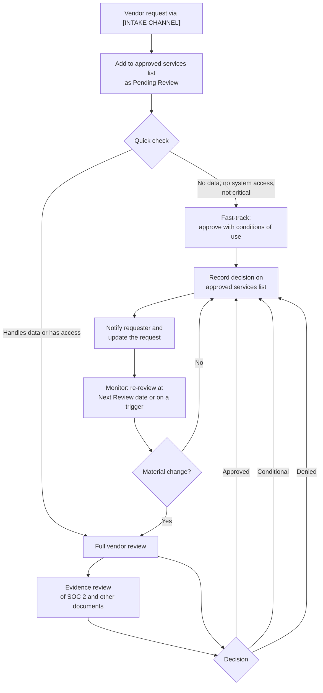

<!--
Template for /tprm:tprm-docs. Replace every [BRACKETED] value, follow the
comments marked "Remove when...", and delete all comments in the finished draft.
-->
# Vendor Review Process

**Status:** DRAFT — requires approval by [APPROVER ROLE]
**Owner:** [PROGRAM OWNER ROLE]
**Policy:** [POLICY PATH]
**Last updated:** [DATE]

## Purpose

Assess third-party vendors before use, record a decision for each, and keep those decisions current, so that no unapproved service handles [CLIENT] data.

## Triggers

- Someone wants to use a new vendor, tool, or service
- A vendor already in use has never been reviewed
- A vendor's Next Review date arrives
- A vendor has a security incident, changes ownership, or changes its terms, or [CLIENT] expands its use

## Process Flow



## Steps

### New request

| Step | Who | Action | Tool | Output |
|------|-----|--------|------|--------|
| 1 | Requester | Submit a vendor review request | [INTAKE CHANNEL] | Request |
| 2 | [PROGRAM OWNER ROLE] | Add the vendor to the list as Pending Review | `/tprm:vendor-github-sync pull` or `/tprm:vendor-tracker add` | Tracker row |
| 3 | [PROGRAM OWNER ROLE] | Triage the request | `/tprm:vendor-quick-check <vendor> [request]` | Quick check record |
| 4 | [PROGRAM OWNER ROLE] | If it isn't fast-tracked, run a full review | `/tprm:vendor-review <vendor> [request]` | Review record and PDF |
| 5 | [PROGRAM OWNER ROLE] | Review any SOC 2 report or other evidence the vendor provides | `/tprm:vendor-evidence-review <vendor>` | Evidence review record |
| 6 | [APPROVER ROLE] | Decide: Approved, Conditional, or Denied | — | Decision |
| 7 | [PROGRAM OWNER ROLE] | Record the decision and the next review date | `/tprm:vendor-tracker record <record>` | Updated tracker |
| 8 | [PROGRAM OWNER ROLE] | Notify the requester, and file the records | `/tprm:vendor-github-sync push` or email | Updated request |

### Ongoing monitoring

| Step | Who | Action | Tool | Output |
|------|-----|--------|------|--------|
| 1 | [PROGRAM OWNER ROLE] | List vendors due or overdue for review, monthly | `/tprm:vendor-tracker due` | Due list |
| 2 | [PROGRAM OWNER ROLE] | Re-review each due vendor, and confirm its conditions are met | `/tprm:vendor-rereview <vendor>` | Re-review record |
| 3 | [PROGRAM OWNER ROLE] | Escalate to a full review after an incident, ownership change, or expanded use | `/tprm:vendor-review <vendor>` | Review record |
| 4 | [APPROVER ROLE] | Confirm or change the decision | `/tprm:vendor-tracker record <record>` | Updated tracker |
| 5 | [PROGRAM OWNER ROLE] | Mark vendors no longer in use as Retired | `/tprm:vendor-tracker retire <vendor>` | Updated tracker |

## Artifacts

| Artifact | Location | Purpose |
|----------|----------|---------|
| Vendor requests | [INTAKE LOCATION] | Intake and notification |
| Approved services list | `[TRACKER PATH]` | Source of truth for vendor decisions |
| Review records | `[REVIEWS PATH]` | Evidence of each assessment |
| Vendor-provided evidence | `[EVIDENCE PATH]` | SOC 2 reports and similar documents; kept out of version control |

## Decision Criteria

| Decision | When |
|----------|------|
| Approved | The vendor meets [CLIENT] requirements with no material concerns |
| Conditional | The vendor is acceptable with specific restrictions, which are recorded on the list and in the review |
| Denied | The risk is unacceptable; the reason is recorded, and the requester may propose alternatives |

## Service Levels

- **Acknowledgment:** [ACK SLA, e.g., 2 business days] after a request is submitted
- **Decision:** [DECISION SLA, e.g., 5 business days for standard reviews and 10 for complex vendors]
- **Re-reviews:** completed within 30 days of the Next Review date

## Tooling

Reviews are prepared with the Konda Security `tprm` Claude Code plugin. Install it with:

```
/plugin install tprm --marketplace https://kondasecurity.com/claude/marketplace.json
```

Records it produces are AI-assisted and are reviewed by [PROGRAM OWNER ROLE] before a decision is made.
